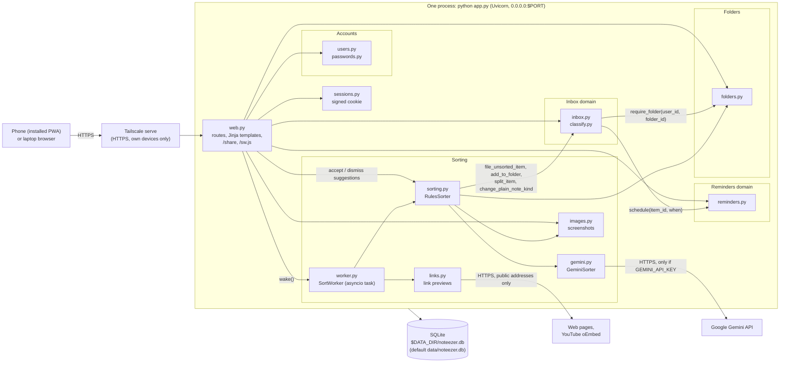
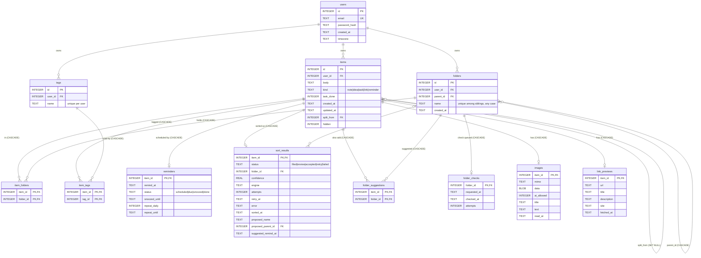

# Diagrams

Both diagrams are drawn from the code as it is on 2026-10-04. GitHub renders the Mermaid blocks.

## Architecture

One process: `python app.py` starts Uvicorn with the FastAPI app from `noteezer/main.py`. The sort worker is an asyncio task inside that process, started in `lifespan`, not a second process.

The two graded domains are **Inbox** (what was saved) and **Reminders** (when it is due). Folders and Sorting are the extra areas added later (ADR-2 updates). Accounts are minimal login, not a domain.

Where the seams are today:

- **Writes across a seam go through a function.** Inbox only calls `schedule` in reminders and `require_folder` in folders. Sorting changes a line only through guarded inbox functions (`file_unsorted_item`, `add_to_folder`, `split_item`, `change_plain_note_kind`, `schedule_unset_reminder`). One exception: `record_reading` in `images.py` replaces the body "Screenshot" with Gemini's title directly in `items`.
- **Reads across a seam still use SQL joins.** `sort_pending` and `check_new_folders` in `sorting.py` read `items`, `item_folders`, `reminders`, and `images` to find work, and `list_items` in `inbox.py` searches the text in `images`. `reminders.py`, `images.py`, and `links.py` join `items` to check that a row belongs to the user. In Assignment 2 these reads become API calls or copies of the `user_id` on the owning table.

## Database

Twelve tables in one SQLite file, created by `noteezer/schema.sql` in `init_db`. Each table is grouped by the module that writes it.

| Module | Tables it writes |
|---|---|
| `users.py` | `users` |
| `inbox.py` | `items`, `item_folders`, `tags`, `item_tags` |
| `reminders.py` | `reminders` |
| `folders.py` | `folders` |
| `sorting.py` | `sort_results`, `folder_suggestions`, `folder_checks` |
| `images.py` | `images` (and `items.body` for a "Screenshot" line, see above) |
| `links.py` | `link_previews` |

`reminders`, `sort_results`, `images`, and `link_previews` use `item_id` as their primary key, so a line has at most one of each, and each is deleted with its line. Deleting a folder never deletes a line: only its `item_folders` rows go, and a line with none left is in Unsorted.
