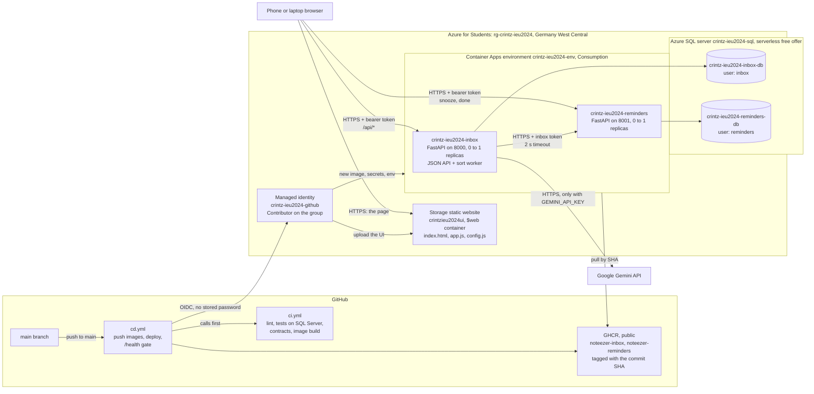
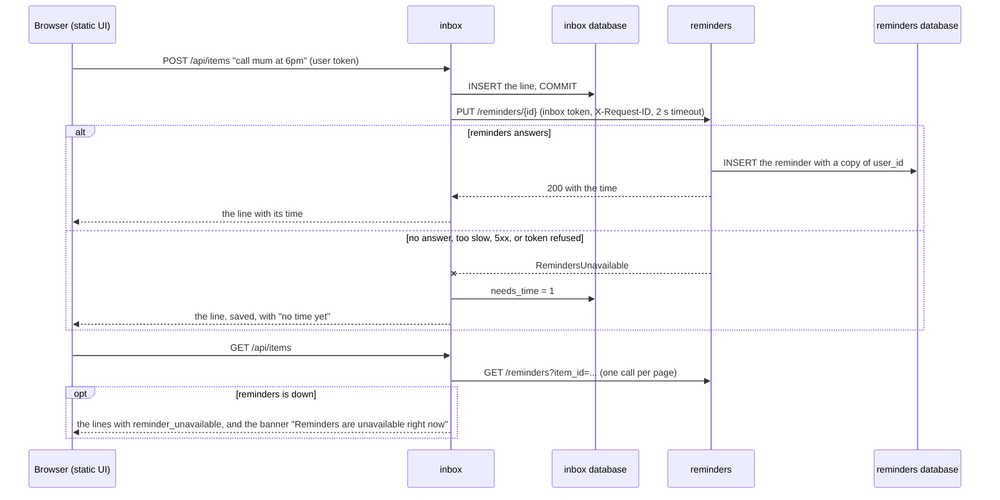
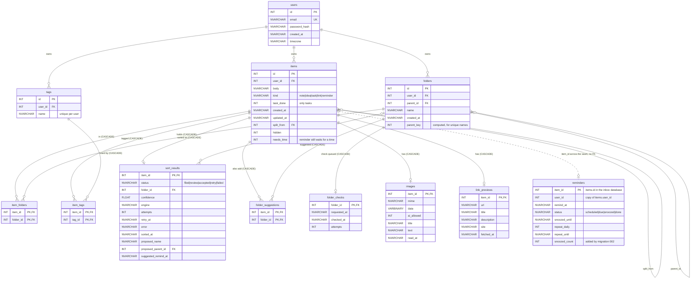
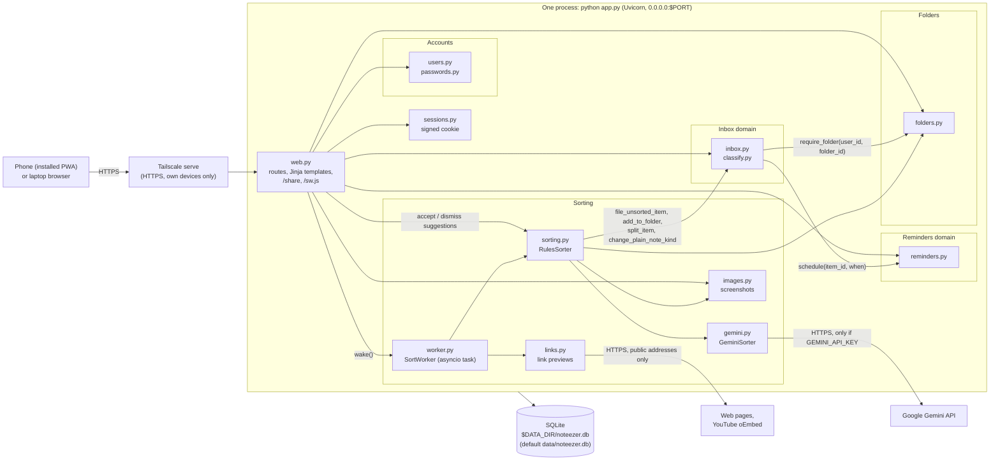
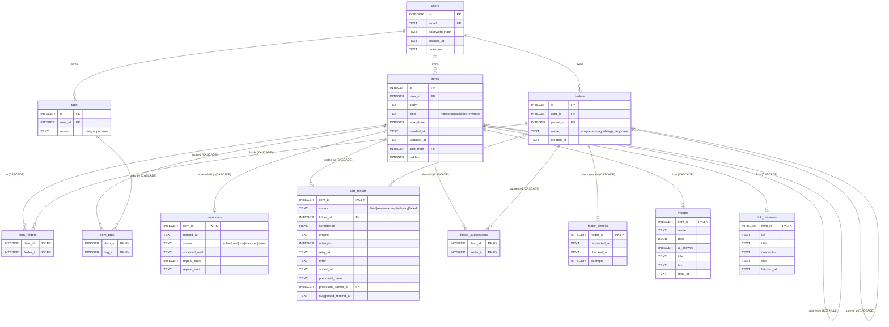

# Diagrams

GitHub renders the Mermaid blocks. The first part is the system as deployed for Assignment 2, drawn from the code and the Azure setup on 2026-11-20. The second part is Assignment 1 as it was on 2026-10-04, kept unchanged as the "before".

## After: two services on Azure (Assignment 2)

### Deployment

The browser talks to three addresses: the static website for the page, and each Container App for its API. Both services accept browser calls only from the website's origin (`CORS_ORIGINS`). Inbox is the only service that calls the other one; reminders never calls inbox. Each service can open only its own database, with its own contained user. Nothing runs while the app is idle: both apps scale to zero and both databases pause after 60 minutes (ADR-8), which is also why reminders are not pushed to the phone (ADR-10).

### Saving a reminder, and what happens when reminders is down

The line is committed before reminders is called, so a reminders failure never loses it (ADR-6). Snooze and done go from the browser straight to reminders, so while it is down they fail with a message, and everything in inbox keeps working.

### Databases

Each service owns its database and runs its own numbered migrations at startup (ADR-7), recorded in its own `schema_migrations` table. There is no foreign key across the seam: `reminders.item_id` points at `items.id` in the other database, and `reminders.user_id` is a copy, so reminders checks ownership without asking inbox.

| Database | Owner | Tables | Migrations |
|---|---|---|---|
| `crintz-ieu2024-inbox-db` | inbox service, user `inbox` | `users`, `items`, `item_folders`, `tags`, `item_tags`, `folders`, `sort_results`, `folder_suggestions`, `folder_checks`, `images`, `link_previews` | `001_init.sql` |
| `crintz-ieu2024-reminders-db` | reminders service, user `reminders` | `reminders` | `001_init.sql`, `002_snoozed_count.sql` |

The dotted line is the one relation that used to be a foreign key with `ON DELETE CASCADE` (ADR-3). Now inbox calls `DELETE /reminders/{id}` after it deletes a line. If reminders is down, the reminder row stays behind; that is harmless, because inbox only shows times for lines that exist and are reminders, and an item id is never reused. Timestamps are ISO 8601 text with a binary collation, so they compare character by character, as in SQLite.

## Before: one process on the laptop (Assignment 1)

Drawn from the code as it was on 2026-10-04.

### Architecture (Assignment 1)

One process: `python app.py` starts Uvicorn with the FastAPI app from `noteezer/main.py`. The sort worker is an asyncio task inside that process, started in `lifespan`, not a second process.

The two graded domains are **Inbox** (what was saved) and **Reminders** (when it is due). Folders and Sorting are the extra areas added later (ADR-2 updates). Accounts are minimal login, not a domain.

Where the seams are today:

- **Writes across a seam go through a function.** Inbox only calls `schedule` in reminders and `require_folder` in folders. Sorting changes a line only through guarded inbox functions (`file_unsorted_item`, `add_to_folder`, `split_item`, `change_plain_note_kind`, `schedule_unset_reminder`). One exception: `record_reading` in `images.py` replaces the body "Screenshot" with Gemini's title directly in `items`.
- **Reads across a seam still use SQL joins.** `sort_pending` and `check_new_folders` in `sorting.py` read `items`, `item_folders`, `reminders`, and `images` to find work, and `list_items` in `inbox.py` searches the text in `images`. `reminders.py`, `images.py`, and `links.py` join `items` to check that a row belongs to the user. In Assignment 2 these reads become API calls or copies of the `user_id` on the owning table.

### Database (Assignment 1)

Twelve tables in one SQLite file, created by `noteezer/schema.sql` in `init_db`. Each table is grouped by the module that writes it.

| Module | Tables it writes |
|---|---|
| `users.py` | `users` |
| `inbox.py` | `items`, `item_folders`, `tags`, `item_tags` |
| `reminders.py` | `reminders` |
| `folders.py` | `folders` |
| `sorting.py` | `sort_results`, `folder_suggestions`, `folder_checks` |
| `images.py` | `images` (and `items.body` for a "Screenshot" line, see above) |
| `links.py` | `link_previews` |

`reminders`, `sort_results`, `images`, and `link_previews` use `item_id` as their primary key, so a line has at most one of each, and each is deleted with its line. Deleting a folder never deletes a line: only its `item_folders` rows go, and a line with none left is in Unsorted.
